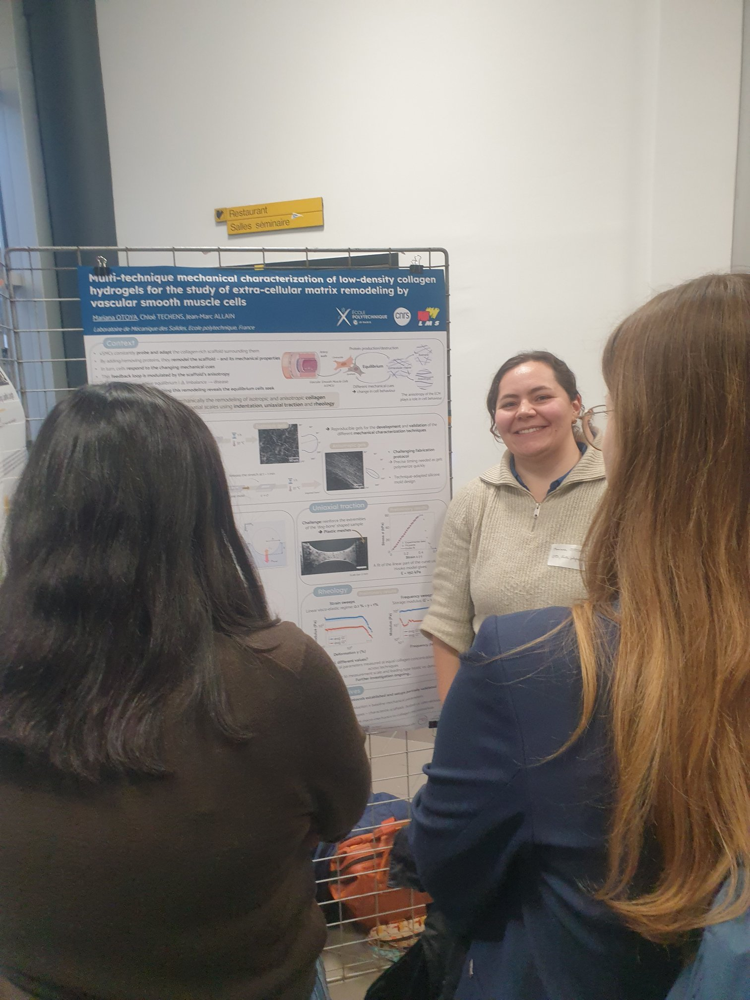
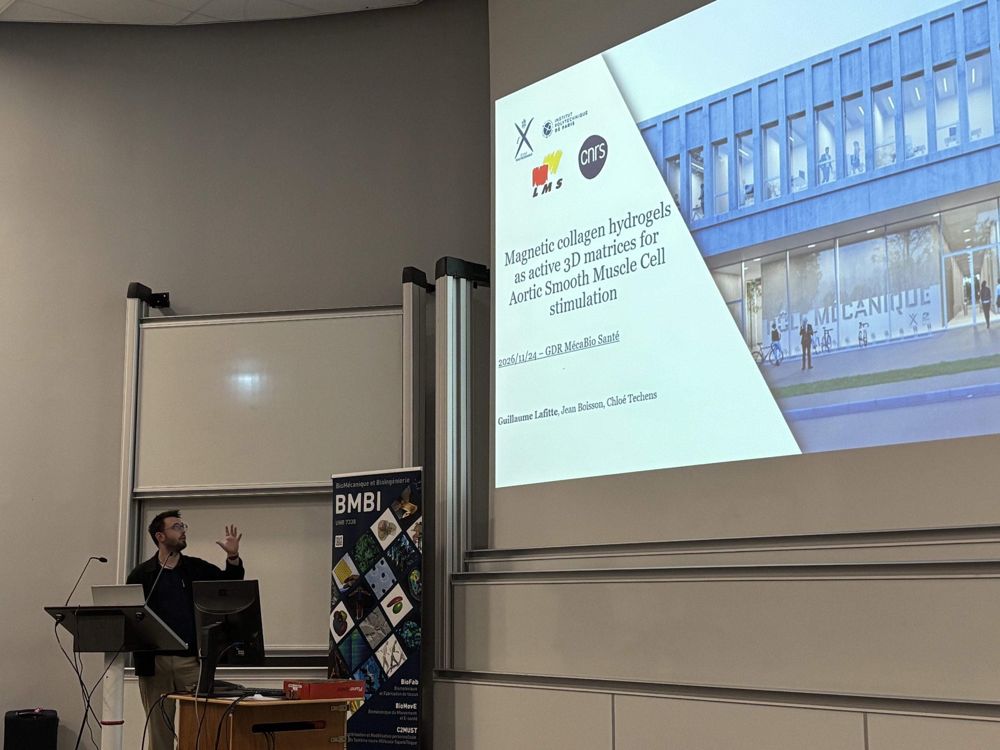
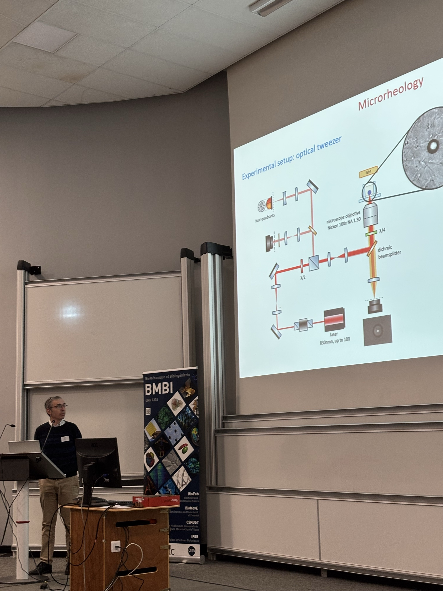

:::{#hero-heading}
:::

## Event summary

From **24 to 26 November 2026**, **Guillaume Lafitte**, **Mariana Otoya** and **Jean-Marc Allain** represented the group at the **5th annual days of the GdR MécaBio Santé**, hosted by the Biomécanique et Bioingénierie lab (BMBI) at UTC, Compiègne.

This year's edition was co-organised with two other research networks, the GdR *Micro et NanoFluidique* and the GdR *Réparer l'Humain*, and featured two mini-symposia:

- **"(Ultra)sound and In Situ Approaches to Probe, Monitor and Reshape Tissues"**, with the GdR *Réparer l'Humain* (organised by Jérôme Sohier);
- **"Microfluidic Approaches for Biomechanics"**, with the GdR *Micro et NanoFluidique* (organised by Pierre Joseph and Magalie Faivre).

Guillaume, Mariana and Jean-Marc presented their work on magnetic collagen hydrogels, the mechanical characterisation of collagen hydrogels, and the rheology of blood clots, respectively.

### Poster by Mariana Otoya

> **Multi-technique mechanical characterization of low-density collagen hydrogels for the study of extracellular matrix remodeling by vascular smooth muscle cells**
>
> *Mariana Otoya, Chloé Techens, Jean-Marc Allain* — Laboratoire de Mécanique des Solides, École polytechnique

Vascular smooth muscle cells constantly probe and remodel the collagen-rich matrix that surrounds them, and the anisotropy of this extracellular matrix strongly influences their behaviour. To characterise this remodelling mechanically, Mariana presented the protocols she developed to fabricate reproducible **isotropic and anisotropic collagen gels** and to test them across spatial scales using:

- **Indentation**, with the contact geometry measured by Optical Coherence Tomography (OCT);
- **Uniaxial tensile testing** on reinforced dog-bone samples;
- **Shear rheology** (time, strain and frequency sweeps).

{fig-align="center" width="60%"}

### Talk by Guillaume Lafitte

> **Magnetic collagen hydrogels as active 3D matrices for aortic smooth muscle cell stimulation**
>
> *Guillaume Lafitte, Jean Boisson, Chloé Techens* — Laboratoire de Mécanique des Solides, École polytechnique & LMI, ENSTA

Guillaume presented his latest work on **magnetic collagen hydrogels**: active 3D matrices that can be actuated remotely to mechanically stimulate aortic smooth muscle cells, with the aim of studying pathologies such as aneurysms. This project is carried out in collaboration with **Jean Boisson** (LMI, ENSTA).

Realistic 3D models of cell stimulation through local matrix loading are still lacking. To address this, collagen hydrogels (2 mg/mL) were prepared with either HCl or 10X PBS and loaded with magnetite nanoparticles (10–20 nm) at 0.1, 0.5 and 1 mg/mL. Their mechanical properties and deformation under static and dynamic magnetic fields were characterised by shear rheology, OCT and digital volume correlation. Preliminary results show that the nanoparticles do not affect the storage modulus of PBS-based gels (≈ 52 Pa), whereas they increase that of HCl-based gels (from 44.6 to 102.5 Pa). Under a magnetic field, particle tracking revealed displacements ranging from 6.4 to 75.8 µm.

{fig-align="center" width="60%"}

### Talk by Jean-Marc Allain

> **Rhéologie et microstructure des caillots sanguins** *(Rheology and microstructure of blood clots)*
>
> *Jean-Marc Allain* — Laboratoire de Mécanique des Solides, École polytechnique

Hypercoagulability is a major cause of deep vein thrombosis and embolism, yet it remains difficult to diagnose in most cases. The team hypothesises that hypercoagulability alters the biochemical cascades driving the formation of the fibrin network, the backbone of a blood clot, and therefore also changes its mechanics. Jean-Marc presented a setup that measures, on the very same clot, the microrheological response (by tracking a micrometric bead) and the network microstructure (by confocal microscopy). This gives access to the storage and loss moduli as well as the fibrin network structure for both healthy clots and clots mimicking hypercoagulability: healthy clots turn out to be softer and less dense.

{fig-align="center" width="60%"}